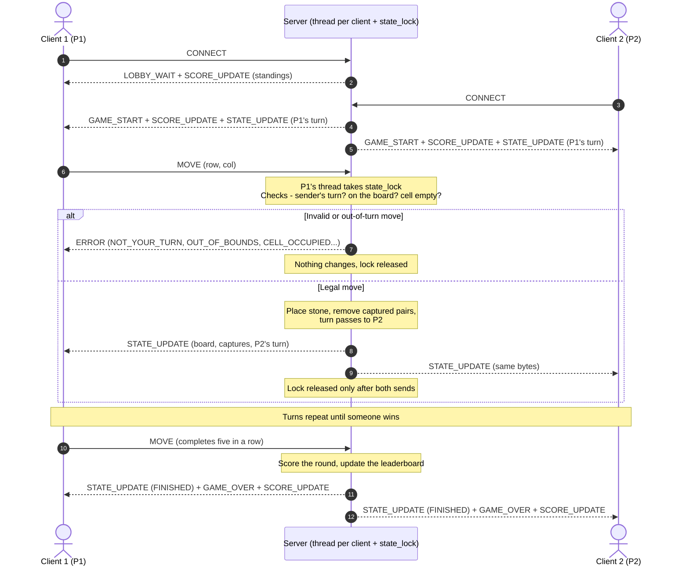

# State & Score Broadcast Sequence Diagram

**Project:** CS 457 Term Project: Networked Pente
**Author:** Bode Kaanta
**Sprint:** 2 (Game Behavior & Server Concurrency Architecture Design)
**Related docs:** [`concurrency_design.md`](concurrency_design.md) (threads, lock rules, scoring) · [`protocol_blueprint.md`](protocol_blueprint.md) (message schemas) · [`fsm_specification.md`](fsm_specification.md) (transition IDs such as L1, G7, D4)

This file has two diagrams. The **summary** shows the core flow in 12 steps: join, one move (valid or rejected), the broadcast to both players, and the end-of-game score update. The **full diagram** follows one complete game through the server's threads. It shows **all 11 message types** and splits the server into the threads that do the work, so you can see **which thread holds `state_lock`** and **which thread sends each broadcast**.

## Summary Diagram

The server is drawn as one box here. To keep it short, some arrows carry more than one message (for example `GAME_START + SCORE_UPDATE + STATE_UPDATE`); the full diagram shows each one separately.

## How to Read the Full Diagram

| Lane | What it is |
|---|---|
| **Client 1 / Client 2** | The two terminal clients (Alice = P1, Bob = P2) |
| **Handler P1 / Handler P2** | The server thread that owns that client's socket and sits in `recv()` |
| **Acceptor** | The server's main thread (`accept()` loop) |
| **Shared state + lock** | The shared server data guarded by the single `state_lock`: `GameState` (board, turn, captures, seats) plus the session leaderboard, which lives outside `GameState` |
| **Grace Timer** | The `threading.Timer` thread that exists only while a game is paused |

- Solid arrows (`->>`) are messages a client sends, or calls between server threads.
- Dashed arrows (`-->>`) are messages the server sends to a client.
- Arrows ending in an **x** (`--x`) are connection failures or TCP closes, not protocol messages.
- Each **`critical`** box is one critical section: the thread named in its label holds `state_lock` from the top of the box to the bottom, and no other thread can change or read the game state until it ends.
- Labels like **L1**, **G7**, **D4** are row IDs from the transition tables in `fsm_specification.md`.
- Payloads are abbreviated. The full schemas are in `protocol_blueprint.md` §3.

## Full Diagram

```mermaid
sequenceDiagram
    autonumber
    actor C1 as Client 1 (Alice, P1)
    participant H1 as Handler P1
    participant AC as Acceptor (main thread)
    participant GS as Shared state + state_lock
    participant TM as Grace Timer
    participant H2 as Handler P2
    actor C2 as Client 2 (Bob, P2)

    rect rgba(46, 160, 67, 0.12)
    Note over C1,C2: Phase 1 - Connect and wait in the lobby
    C1->>AC: TCP connect to port 5457 (3-way handshake)
    AC->>GS: register_connection(conn-1)
    AC->>H1: start handler thread conn-1
    C1->>H1: CONNECT {alias: "Alice", protocol_version: 1}
    critical Handler P1 holds state_lock
        H1->>GS: dispatch CONNECT
        Note over GS: L1 - seat Alice as P1<br/>state = ONE_PLAYER
        H1-->>C1: LOBBY_WAIT {players_connected: 1, players_needed: 2}
        H1-->>C1: SCORE_UPDATE {reason: STANDINGS, leaderboard}
    end
    Note over H1: Back in recv(), lock released
    end

    rect rgba(56, 139, 253, 0.12)
    Note over C1,C2: Phase 2 - Second player joins and the game starts
    C2->>AC: TCP connect to port 5457
    AC->>GS: register_connection(conn-2)
    AC->>H2: start handler thread conn-2
    C2->>H2: CONNECT {alias: "Bob", protocol_version: 1}
    critical Handler P2 holds state_lock
        H2->>GS: dispatch CONNECT
        Note over GS: L3 - seat Bob as P2<br/>G1 - game_id += 1, make session tokens<br/>turn_number = 0, active = P1
        H2-->>C1: GAME_START {your_player_id: P1, session_token, resumed: false}
        H2-->>C2: GAME_START {your_player_id: P2, session_token, resumed: false}
        H2-->>C1: SCORE_UPDATE {reason: STANDINGS, leaderboard}
        H2-->>C2: SCORE_UPDATE {reason: STANDINGS, leaderboard}
        H2-->>C1: STATE_UPDATE {turn_number: 0, active_player: P1, captures 0-0}
        H2-->>C2: STATE_UPDATE (same bytes)
    end
    Note over C1,C2: A third client would get ERROR ROOM_FULL (fatal) - L7
    end

    rect rgba(210, 153, 34, 0.12)
    Note over C1,C2: Phase 3 - One turn - two moves race for the lock
    par Alice moves on her turn
        C1->>H1: MOVE {row: 9, col: 9}
    and Bob tries to move early
        C2->>H2: MOVE {row: 8, col: 8}
    end
    Note over H1,H2: Both threads call on_message() - the lock lets only one in
    critical Handler P2 got the lock first
        H2->>GS: dispatch MOVE from P2
        Note over GS: G3 - active player is P1, reject<br/>board and turn unchanged
        H2-->>C2: ERROR {code: NOT_YOUR_TURN, fatal: false}
    end
    Note over H1: Was blocked on acquire, now gets the lock
    critical Handler P1 holds state_lock
        H1->>GS: dispatch MOVE from P1
        Note over GS: Validate in order - game ACTIVE, sender is active,<br/>row/col are ints, inside 0-18, cell empty
        alt Invalid move (bad payload, out of bounds, cell occupied)
            H1-->>C1: ERROR {code: OUT_OF_BOUNDS, fatal: false}
            Note over GS: G4 to G6 - nothing changes, P1 keeps the turn
        else Legal move
            Note over GS: G7 - place stone, remove captured pairs,<br/>captures[P1] += pairs taken<br/>G11 - no win, turn_number += 1, active = P2
            H1-->>C1: STATE_UPDATE {board, turn_number: 1, active_player: P2, captures, last_move}
            H1-->>C2: STATE_UPDATE (same bytes, sent by P1's thread)
        end
    end
    Note over C1,C2: Both clients now show the same board and the same turn<br/>The same pattern repeats for every turn until the game ends
    end

    rect rgba(248, 81, 73, 0.12)
    Note over C1,C2: Phase 4 - Unexpected drop and rejoin
    Note over H2,C2: Bob's program crashes or his link is cut
    C2--xH2: TCP RST, FIN, or silence
    Note over H2: recv() raises ConnectionResetError,<br/>returns EOF, or keepalive times out
    critical Handler P2 holds state_lock
        H2->>GS: on_connection_lost(conn-2)
        Note over GS: D2 - seat P2 disconnected<br/>state = PAUSED_RECONNECT, pause_seq += 1
        H2->>TM: start Timer(60 s, game_id, pause_seq)
        H2-->>C1: PLAYER_STATUS {subject_player: P2, status: DISCONNECTED, grace_seconds_remaining: 60}
        H2-->>C1: STATE_UPDATE {game_status: PAUSED_RECONNECT, active_player: null}
    end
    Note over H2: Closes socket conn-2, thread exits
    opt Alice tries to move while paused
        C1->>H1: MOVE {row: 10, col: 10}
        critical Handler P1 holds state_lock
            H1-->>C1: ERROR {code: GAME_NOT_ACTIVE, fatal: false}
        end
    end
    C2->>AC: New TCP connection (within 60 s)
    AC->>GS: register_connection(conn-3)
    AC->>H2: start handler thread conn-3 (new P2 handler)
    C2->>H2: RECONNECT {alias: "Bob", session_token, protocol_version: 1}
    critical Handler P2 (conn-3) holds state_lock
        H2->>GS: dispatch RECONNECT
        alt Token and alias match the paused seat
            Note over GS: D4 - bind conn-3 to seat P2<br/>state = PLAYER_TURN (same active player)
            H2->>TM: cancel()
            H2-->>C2: GAME_START {your_player_id: P2, resumed: true}
            H2-->>C2: SCORE_UPDATE {reason: STANDINGS, leaderboard}
            H2-->>C1: PLAYER_STATUS {subject_player: P2, status: RECONNECTED}
            H2-->>C1: STATE_UPDATE {game_status: ACTIVE}
            H2-->>C2: STATE_UPDATE (same bytes)
        else Wrong token or alias
            H2-->>C2: ERROR {code: INVALID_TOKEN, fatal: true}
            Note over H2: Closes conn-3, the game stays paused - D5
        end
    end
    end

    rect rgba(163, 113, 247, 0.12)
    Note over C1,C2: Phase 5 - Round completion, score and leaderboard sync
    alt Win by play (five in a row or fifth capture)
        C1->>H1: MOVE {row: 9, col: 13}
        critical Handler P1 holds state_lock
            H1->>GS: dispatch MOVE from P1
            Note over GS: G7 then G8 - five in a row, state = GAME_OVER<br/>Score round - five-in-a-row bonus 5 + 1 per pair + 1 per four<br/>Update leaderboard for Alice and Bob
            H1-->>C1: STATE_UPDATE {game_status: FINISHED, active_player: null}
            H1-->>C2: STATE_UPDATE (same bytes)
            H1-->>C1: GAME_OVER {result: WIN, winner: P1, win_reason: FIVE_IN_A_ROW}
            H1-->>C2: GAME_OVER (same bytes)
            H1-->>C1: SCORE_UPDATE {reason: ROUND_COMPLETE, round points, leaderboard}
            H1-->>C2: SCORE_UPDATE (same bytes)
            Note over GS: CLEANUP - reset GameState, keep leaderboard,<br/>shutdown() both player sockets
        end
    else Bob quits on purpose
        C2->>H2: DISCONNECT {reason: USER_QUIT}
        critical Handler P2 holds state_lock
            H2->>GS: dispatch DISCONNECT
            Note over GS: D1 - forfeit, winner P1 (OPPONENT_QUIT)<br/>Score round and update leaderboard
            H2-->>C1: STATE_UPDATE {game_status: FINISHED}
            H2-->>C1: GAME_OVER {result: FORFEIT, winner: P1, win_reason: OPPONENT_QUIT}
            H2-->>C1: SCORE_UPDATE {reason: ROUND_COMPLETE, round points, leaderboard}
            Note over GS: CLEANUP
        end
    else Bob dropped and never came back
        TM->>GS: on_grace_timeout(game_id, pause_seq) after 60 s
        critical Grace Timer thread holds state_lock
            Note over GS: Stale-timer guard - still PAUSED_RECONNECT<br/>with the same game_id and pause_seq?<br/>D7 - forfeit, winner P1 (OPPONENT_TIMEOUT)<br/>Score round and update leaderboard
            TM-->>C1: STATE_UPDATE {game_status: FINISHED}
            TM-->>C1: GAME_OVER {result: FORFEIT, winner: P1, win_reason: OPPONENT_TIMEOUT}
            TM-->>C1: SCORE_UPDATE {reason: ROUND_COMPLETE, round points, leaderboard}
            Note over GS: CLEANUP
        end
    end
    H1--xC1: TCP FIN (server closes the connection)
    H2--xC2: TCP FIN (if Bob is still connected)
    Note over H1,H2: Handlers see EOF, hold no seat (X1), close their sockets, and exit
    Note over GS: state = WAITING_FOR_PLAYERS / LOBBY_EMPTY<br/>Leaderboard is kept for the next game
    end
```

## Narrative (Full Diagram)

Step numbers below refer to the full diagram.

### Phase 1: Connect and wait in the lobby (steps 1–7)

The **Acceptor** (main thread) only does `accept()`. For each new socket it registers the connection under the lock and starts a dedicated **handler thread**, then goes straight back to `accept()`. It never reads game messages, so it can't be blocked by a slow client. Alice's handler receives `CONNECT`, takes `state_lock`, seats her as P1 (L1), and replies with `LOBBY_WAIT` and the current standings in `SCORE_UPDATE`. Then it releases the lock and goes back to `recv()`.

### Phase 2: Game start (steps 8–18)

Bob's `CONNECT` is processed by **Bob's** handler. Inside one critical section it seats P2 (L3), starts the game (G1), and sends each player their own `GAME_START`. The two differ in `your_player_id` and `session_token`. It then sends both players the standings and the identical first `STATE_UPDATE`. A third client can connect at the TCP level, but its `CONNECT` is answered with a fatal `ERROR ROOM_FULL` (L7).

### Phase 3: A turn, move validation, and turn enforcement (steps 19–26)

This phase shows why the lock matters. Alice (her turn) and Bob (not his turn) both send a `MOVE` at the same moment, so two handler threads call `on_message()` at once. `state_lock` lets only one in at a time:

- Here Bob's thread wins the lock first. The server checks the **socket's seat** against `active_player`, finds it is P1's turn, and sends `ERROR NOT_YOUR_TURN` **only to Bob**. The board and turn are untouched (G3).
- Alice's thread, which was blocked on the lock, now enters. The move is validated in the fixed order from blueprint §3.4. An invalid move (here `OUT_OF_BOUNDS`) gets a non-fatal `ERROR` to Alice only, and she keeps the turn (G4–G6). A legal move is applied: the stone is placed, captured pairs are removed, and captures are counted (G7). With no win, `turn_number` increments (G11).
- **Broadcast:** still inside the same critical section, **Alice's thread** sends the same `STATE_UPDATE` bytes to Alice and then to Bob. Bob's own thread is not involved; it is still sitting in `recv()`. Because the lock is released only after both sends, nothing can happen between them. Both clients always receive the same sequence of states, and the live capture score is synced after every move.

### Phase 4: Unexpected drop and rejoin (steps 27–45)

When Bob's connection dies, his handler's `recv()` fails (RST, EOF, or keepalive timeout). It takes the lock, pauses the game (D2), starts the 60 s **Grace Timer** thread, and tells Alice with `PLAYER_STATUS` and a paused `STATE_UPDATE`. Then the handler closes its socket and exits. While paused, any `MOVE` gets `GAME_NOT_ACTIVE`. When Bob reconnects on a **new** TCP connection, a **new** handler thread receives `RECONNECT`. If the token matches, it cancels the timer, re-binds the seat to the new connection, and sends Bob `GAME_START (resumed: true)` plus the standings. It tells Alice `RECONNECTED` and broadcasts the resumed `STATE_UPDATE` (D4). A wrong token is rejected with a fatal `INVALID_TOKEN`, and the game stays paused (D5).

### Phase 5: Round completion, score and leaderboard sync (steps 46–64)

A game can end in three ways, and each is handled by a different thread:

| Ending | Thread holding the lock | FSM row |
|---|---|---|
| Five in a row / fifth capture | The winner's handler | G8 / G9 |
| Opponent sends `DISCONNECT` | The quitter's handler | D1 |
| Opponent's 60 s grace period runs out | The Grace Timer thread | D7 |

Whichever thread it is, it runs the same steps in **one** critical section (concurrency design §6.3):

1. Set the state to `GAME_OVER`.
2. Score the round for both players: a 5-point bonus for five in a row (only that kind of win), 1 per captured pair, and 1 per four-in-a-row left on the final board.
3. Add those points to each alias's record in the session leaderboard. The leaderboard lives outside `GameState`, so it survives the reset.
4. Broadcast, in a fixed order, to every still-connected player: `STATE_UPDATE (FINISHED)` → `GAME_OVER` → `SCORE_UPDATE (ROUND_COMPLETE)`.
5. Run `CLEANUP`.

Because scoring, the leaderboard update, and all three broadcasts share one critical section, a client can never see a score table that disagrees with the result just before it. The grace timer re-checks the state, `game_id`, and `pause_seq` before acting (the stale-timer guard), so a timer that fired just as Bob rejoined does nothing. Finally, the server shuts down the player sockets. The handler threads see EOF and exit, and the server returns to the lobby with the leaderboard kept for the next game.

## Message Coverage Checklist

| Message type | Direction | Shown in phase |
|---|---|---|
| `CONNECT` | Client → Server | Phases 1, 2 |
| `LOBBY_WAIT` | Server → Client | Phase 1 |
| `GAME_START` | Server → Client | Phase 2 (new), Phase 4 (resumed) |
| `MOVE` | Client → Server | Phases 3, 4, 5 |
| `STATE_UPDATE` | Server → Both | Phases 2, 3, 4, 5 |
| `ERROR` | Server → Client | Phase 3 (`NOT_YOUR_TURN`, `CELL_OCCUPIED`), Phase 4 (`GAME_NOT_ACTIVE`, `INVALID_TOKEN`) |
| `DISCONNECT` | Client → Server | Phase 5 |
| `GAME_OVER` | Server → Both | Phase 5 (`WIN`, `FORFEIT`) |
| `RECONNECT` | Client → Server | Phase 4 |
| `PLAYER_STATUS` | Server → Client | Phase 4 (`DISCONNECTED`, `RECONNECTED`) |
| `SCORE_UPDATE` | Server → Client(s) | Phases 1, 2, 4 (`STANDINGS`), Phase 5 (`ROUND_COMPLETE`) |
