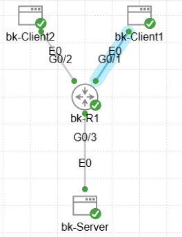
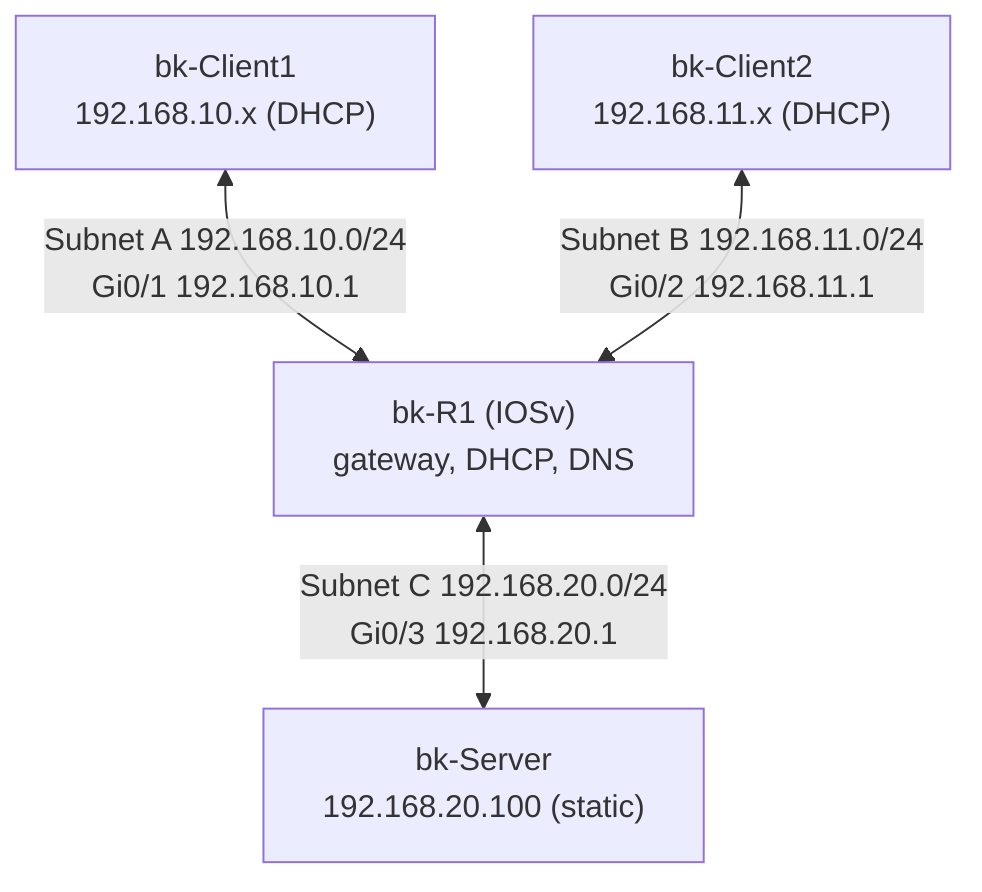
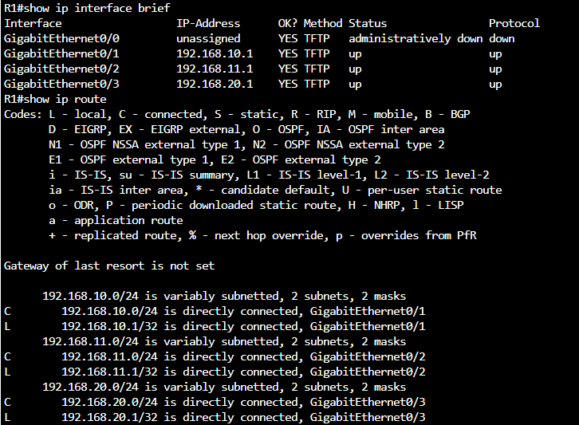
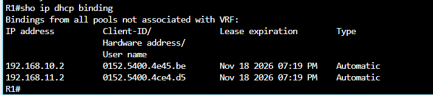
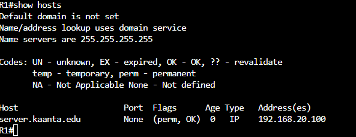
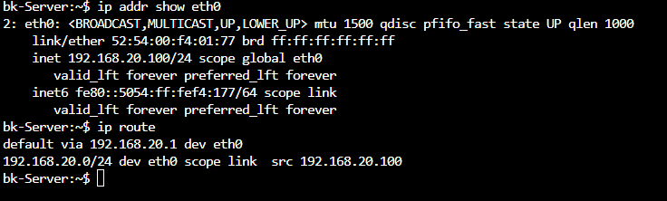
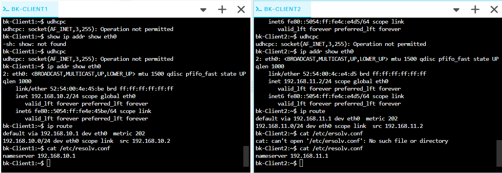
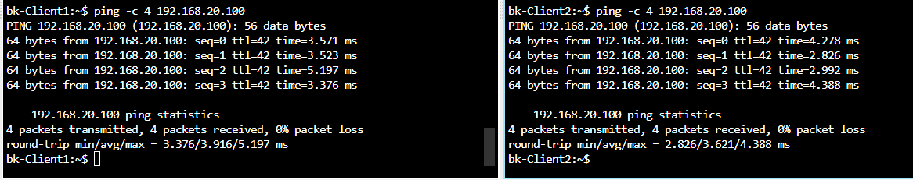
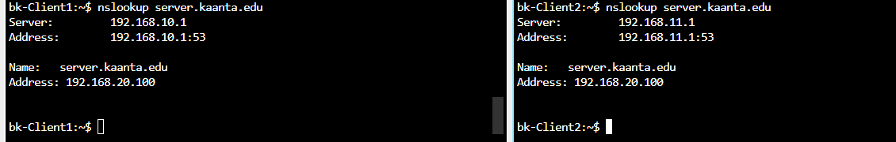
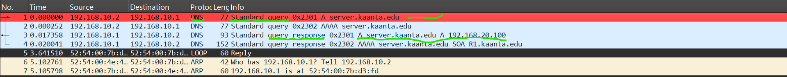

# Sprint 4 Network Verification Report: CML 1-Router Topology

**Project:** CS 457 Term Project: Networked Pente
**Author:** Bode Kaanta
**Sprint:** 4 (CML 1-Router Network Topology & Infrastructure Deployment)
**Server name:** `server.kaanta.edu` → `192.168.20.100`
**Files:** [`sprint_4_topology.yaml`](sprint_4_topology.yaml) (CML export) · [`sprint_4_dns_lookup.pcap`](sprint_4_dns_lookup.pcap) (DNS capture) · [`cml/R1.cfg`](cml/R1.cfg) (router configuration)

## Summary

One Cisco IOSv router, **R1** (CML node `bk-R1`), connects three subnets: Client 1, Client 2, and the game server. R1 is each subnet's default gateway. It leases addresses to the two clients from two DHCP pools, and it answers DNS queries for `server.kaanta.edu` from its own host table. The server has the static address 192.168.20.100 with R1 as its default gateway. Both clients reach the server across the router, and the DNS capture shows `server.kaanta.edu` resolving to 192.168.20.100. That lookup is what the Pente client (`client.py -i server.kaanta.edu`) depends on in Sprint 5.

Where to find the evidence for each rubric criterion:

| Rubric criterion (50 pts each) | Evidence |
|---|---|
| 1. Single-router multi-subnet architecture and addressing: `ip routing`; Gi0/1, Gi0/2, Gi0/3 on 192.168.10.1/24, 192.168.11.1/24, 192.168.20.1/24, all up/up with connected routes; server static 192.168.20.100/24 with default route via 192.168.20.1 | §1 topology, §2.1 configuration, §3 `show ip interface brief` and `show ip route`, §4 server |
| 2. DHCP multi-subnet allocation: `CLIENT1_POOL` and `CLIENT2_POOL`, gateways excluded, default router and DNS server in each pool, active leases for both clients | §2.3 configuration, §3 `show ip dhcp binding`, §5 client leases |
| 3. Authoritative DNS: `ip dns server` and `ip host server.kaanta.edu 192.168.20.100`; `nslookup` resolves on both clients | §2.2 configuration, §3 `show hosts`, §7 `nslookup` on both clients |
| 4. Cross-subnet connectivity and DNS capture: zero-loss pings from both clients; annotated capture of the client query to R1 (UDP 53) and R1's response with 192.168.20.100, taken on the Client 1 link | §6 pings, §8 and [`sprint_4_dns_lookup.pcap`](sprint_4_dns_lookup.pcap) (every DNS packet carries a Wireshark comment) |
| 5. CML export and this report: `sprint_4_topology.yaml` with `bk-R1`, `bk-Client1`, `bk-Client2`, `bk-Server`; topology screenshot, router outputs, client `ping`/`nslookup` logs, annotated Wireshark screenshot | [`sprint_4_topology.yaml`](sprint_4_topology.yaml), §1, §3, §5–§7, §8 |

---

## 1. Topology

The CML canvas: the custom node names, the three links, and the router and host interfaces on each link.



| Node | Role | Interface | IPv4 address | How it is assigned |
|---|---|---|---|---|
| `bk-R1` | Router, gateway, DHCP and DNS server | Gi0/1 | 192.168.10.1/24 | Static (Subnet A gateway) |
| | | Gi0/2 | 192.168.11.1/24 | Static (Subnet B gateway) |
| | | Gi0/3 | 192.168.20.1/24 | Static (Subnet C gateway) |
| `bk-Client1` | Pente client 1 | eth0 ↔ R1 Gi0/1 | 192.168.10.x/24 | DHCP, pool `CLIENT1_POOL` |
| `bk-Client2` | Pente client 2 | eth0 ↔ R1 Gi0/2 | 192.168.11.x/24 | DHCP, pool `CLIENT2_POOL` |
| `bk-Server` | Pente game server | eth0 ↔ R1 Gi0/3 | 192.168.20.100/24 | Static, gateway 192.168.20.1 |



Because all three subnets are directly connected to R1, R1 routes between them using only its connected routes. No static routes or routing protocol are needed.

> **Change from the earlier plan:** the SOW (Sprints 0–3) planned two routers, with DNS on R2 behind a 10.0.0.0/30 backbone. Sprint 4 uses one router, so R1 is now the gateway, DHCP server, **and** DNS server, and each client's DNS server is its own gateway address. The SOW (§5) and the protocol blueprint have been updated to match.

## 2. Router R1 configuration

The full configuration is in [`cml/R1.cfg`](cml/R1.cfg). The parts that matter:

### 2.1 Interfaces and routing

```text
hostname R1
ip routing
interface GigabitEthernet0/1
 ip address 192.168.10.1 255.255.255.0
 no shutdown
interface GigabitEthernet0/2
 ip address 192.168.11.1 255.255.255.0
 no shutdown
interface GigabitEthernet0/3
 ip address 192.168.20.1 255.255.255.0
 no shutdown
```

### 2.2 DNS: R1 is authoritative for the game server's name

```text
ip domain lookup
ip dns server
ip dns primary kaanta.edu soa R1.kaanta.edu admin.kaanta.edu
ip host server.kaanta.edu 192.168.20.100
```

`ip dns server` makes R1 answer DNS queries on UDP/TCP port 53 on all of its interfaces. `ip host` adds a static A record to R1's host table. `ip dns primary` makes R1 the primary DNS server (the start of authority, SOA) for the `kaanta.edu` zone. With all three, R1's answers are marked **authoritative**: the AA flag is set in §8.

> **Found while testing:** with only `ip dns server` and `ip host`, IOS answered correctly but *without* the AA flag, and the client's `nslookup` printed "Non-authoritative answer". Adding `ip dns primary` fixed that. The capture in §8 shows the AA flag set, and R1's reply to the IPv6 query carries the zone's SOA record naming `R1.kaanta.edu`.

### 2.3 DHCP: one pool per client subnet

```text
ip dhcp excluded-address 192.168.10.1
ip dhcp excluded-address 192.168.11.1
ip dhcp pool CLIENT1_POOL
 network 192.168.10.0 255.255.255.0
 default-router 192.168.10.1
 dns-server 192.168.10.1
ip dhcp pool CLIENT2_POOL
 network 192.168.11.0 255.255.255.0
 default-router 192.168.11.1
 dns-server 192.168.11.1
```

R1 chooses the pool from the interface the DHCP Discover arrives on. A Discover on Gi0/1 (192.168.10.1/24) matches `CLIENT1_POOL`'s `network` statement; one on Gi0/2 matches `CLIENT2_POOL`. `default-router` is DHCP option 3 (the client's default gateway). `dns-server` is option 6, which ends up as `nameserver` in the client's `/etc/resolv.conf`. Each pool's gateway is excluded so it is never leased to a client.

## 3. Router verification

### `show ip interface brief` and `show ip route`



- `show ip interface brief`: Gi0/1 (192.168.10.1), Gi0/2 (192.168.11.1), and Gi0/3 (192.168.20.1) are all **up / up**. Gi0/0 is unused and administratively down, as configured.
- `show ip route`: three connected (**C**) routes, for 192.168.10.0/24 on Gi0/1, 192.168.11.0/24 on Gi0/2, and 192.168.20.0/24 on Gi0/3, each with its local (**L**) /32 route for R1's own address. There are no static routes and no gateway of last resort, because every subnet is directly connected.

### `show ip dhcp binding`



Two active **Automatic** (dynamic) leases, one from each pool: **192.168.10.2** from `CLIENT1_POOL` and **192.168.11.2** from `CLIENT2_POOL`. The client IDs identify the clients by MAC address: `0152.5400.4e45.be` is bk-Client1's eth0 (`52:54:00:4e:45:be`) and `0152.5400.4ce4.d5` is bk-Client2's eth0 (`52:54:00:4c:e4:d5`), as §5 shows. The leading `01` means Ethernet.

### `show hosts` (extra, supports §2.2)



R1's host table holds the static entry `server.kaanta.edu` → `192.168.20.100` with flags `(perm, OK)`: a permanent entry from the `ip host` command.

## 4. Game server: static address and default gateway

Commands on `bk-Server`:

```sh
sudo ip addr add 192.168.20.100/24 dev eth0
sudo ip link set eth0 up
sudo ip route add default via 192.168.20.1
```

The default route is what lets the server answer the clients. The client subnets are not 192.168.20.0/24, so without it the server would receive a ping or a TCP SYN from 192.168.10.x but have no route to send the reply back ("Network is unreachable").

`ip addr show eth0` and `ip route` on `bk-Server`:



eth0 is up with the static address **192.168.20.100/24**, and the routing table has **default via 192.168.20.1** (R1 Gi0/3) plus the connected 192.168.20.0/24 route.

## 5. Client DHCP leases

Commands on each client:

```sh
sudo ip link set eth0 up
sudo udhcpc -i eth0
ip addr show eth0
ip route
cat /etc/resolv.conf
```

These show the three things DHCP delivered: the leased **address**, the **default route** via the client's gateway, and R1 as the **DNS server**.

bk-Client1 (left) and bk-Client2 (right):



| | bk-Client1 (Subnet A) | bk-Client2 (Subnet B) |
|---|---|---|
| Leased address (`ip addr show eth0`) | **192.168.10.2/24** | **192.168.11.2/24** |
| Default gateway (`ip route`, DHCP option 3) | **default via 192.168.10.1** | **default via 192.168.11.1** |
| DNS server (`/etc/resolv.conf`, DHCP option 6) | **nameserver 192.168.10.1** | **nameserver 192.168.11.1** |
| MAC address (matches §3 `show ip dhcp binding`) | 52:54:00:4e:45:be | 52:54:00:4c:e4:d5 |

The clients already held their leases when these commands ran. The `udhcpc: socket(...): Operation not permitted` lines are from running `udhcpc` without `sudo`, which only root can do; they did not change the existing leases. The `metric 202` on the default route shows it was installed by the DHCP client.

## 6. Connectivity: clients ping the game server

`ping -c 4 192.168.20.100` from each client. The packets cross R1 from Subnet A or B into Subnet C, and the replies come back through the server's default gateway.

bk-Client1 (left) and bk-Client2 (right):



Both clients: **4 packets transmitted, 4 packets received, 0% packet loss**. Average round trip: 3.9 ms from Client 1 and 3.6 ms from Client 2.

## 7. DNS resolution from the clients

`nslookup server.kaanta.edu` on each client. The client sends the query to the DNS server it learned from DHCP (its own gateway on R1), and R1 answers from its host table.

BusyBox `nslookup` on Alpine looks up both the IPv4 (A) and the IPv6 (AAAA) address. The A answer is `192.168.20.100`. R1 has no IPv6 address for the server, so the AAAA answer is empty. Before `ip dns primary` was added (§2.2), `nslookup` printed "Non-authoritative answer" and `*** Can't find server.kaanta.edu: No answer` for that empty IPv6 reply. With R1 authoritative, neither line appears.

bk-Client1 (left) and bk-Client2 (right):



Each client asks its own gateway, the DNS server from DHCP: Client 1 asks `192.168.10.1:53` and Client 2 asks `192.168.11.1:53`. Both get **`server.kaanta.edu` → `192.168.20.100`**.

## 8. Wireshark DNS capture (`sprint_4_dns_lookup.pcap`)

**How it was captured:** a CML packet capture on the link between `bk-R1` Gi0/1 and `bk-Client1` eth0, running while `nslookup server.kaanta.edu` ran on `bk-Client1`.

**Annotations:** every DNS packet in [`sprint_4_dns_lookup.pcap`](sprint_4_dns_lookup.pcap) carries a Wireshark packet comment explaining it, and the file has a capture comment saying where and how it was captured. In Wireshark, a packet's comment appears at the top of its details pane under *Packet comments*, and *Statistics → Capture File Properties* lists them all. The comments were added with `python tools/dns_pcap_report.py dns_raw.pcap --annotate sprint_4_dns_lookup.pcap`, which copies the raw CML capture unchanged (same packets, same timestamps) and adds the comments. The file is stored in pcapng format, because the classic pcap format cannot hold comments; Wireshark opens it normally.



*Annotated in green:* **frame 1**, the DNS **standard query** for `server.kaanta.edu` (A record) from Client 1 (192.168.10.2) to R1 (192.168.10.1); and **frame 3**, R1's **query response** with the answer **`server.kaanta.edu` A `192.168.20.100`**. Wireshark's bracket in the left margin links frame 1 to its response, frame 3: both carry transaction ID 0x2301. Frames 2 and 4 are the matching IPv6 (AAAA) query and its empty reply.

### Annotated exchange

Wireshark's packet list for the capture (`tshark -r sprint_4_dns_lookup.pcap`):

```text
    1 0.000000000 192.168.10.2 → 192.168.10.1 DNS 77 Standard query 0x2301 A server.kaanta.edu
    2 0.000252000 192.168.10.2 → 192.168.10.1 DNS 77 Standard query 0x2302 AAAA server.kaanta.edu
    3 0.017358000 192.168.10.1 → 192.168.10.2 DNS 93 Standard query response 0x2301 A server.kaanta.edu A 192.168.20.100
    4 0.020041000 192.168.10.1 → 192.168.10.2 DNS 152 Standard query response 0x2302 AAAA server.kaanta.edu SOA R1.kaanta.edu
    5 3.641510000 52:54:00:7b:d3:fd → 52:54:00:7b:d3:fd LOOP 60 Reply
    6 5.102761000 52:54:00:4e:45:be → 52:54:00:7b:d3:fd ARP 42 Who has 192.168.10.1? Tell 192.168.10.2
    7 5.105798000 52:54:00:7b:d3:fd → 52:54:00:4e:45:be ARP 60 192.168.10.1 is at 52:54:00:7b:d3:fd
```

Frames 1–4 are the lookup. Frames 5–7 are background traffic on the link, not DNS: R1's Ethernet keepalive (IOS sends a loopback frame to its own MAC on Gi0/1), and Client 1 confirming R1's MAC address with ARP.

Output of `python tools/dns_pcap_report.py sprint_4_dns_lookup.pcap`:

7 packets read, 4 DNS messages.

DNS messages in `sprint_4_dns_lookup.pcap` (UDP port 53):

| No. | Time (s) | Source | Destination | Type | Transaction ID | Question | Answer | Flags |
|---|---|---|---|---|---|---|---|---|
| 1 | 0.000000 | 192.168.10.2:44452 | 192.168.10.1:53 | Standard query | 0x2301 | server.kaanta.edu A |  | RD |
| 2 | 0.000252 | 192.168.10.2:44452 | 192.168.10.1:53 | Standard query | 0x2302 | server.kaanta.edu AAAA |  | RD |
| 3 | 0.017358 | 192.168.10.1:53 | 192.168.10.2:44452 | Standard query response | 0x2301 | server.kaanta.edu A | A 192.168.20.100 | QR AA RD RA |
| 4 | 0.020041 | 192.168.10.1:53 | 192.168.10.2:44452 | Standard query response | 0x2302 | server.kaanta.edu AAAA | (no answer) | QR AA RD RA |

Annotation of the required lookup:

- **Frame 1: DNS Standard Query.** 192.168.10.2 (the client) sends a UDP datagram from port 44452 to 192.168.10.1 port 53, the DNS server on R1 that DHCP gave the client. It asks for the **A record** (IPv4 address) of `server.kaanta.edu`. Transaction ID 0x2301; flags: RD (RD = recursion desired).
- **Frame 3: DNS Standard Query Response.** 192.168.10.1 port 53 answers back to 192.168.10.2 port 44452 17.4 ms later with the same transaction ID 0x2301, which is how the client matches it to its query. Flags: QR AA RD RA (QR = this is a response, AA = authoritative answer: R1 is the primary DNS server for the zone (`ip dns primary`) and the record comes from its `ip host` table). Reply code NOERROR. Answer: **`server.kaanta.edu` A 192.168.20.100** (TTL 10 s).
- Other queries in the capture (AAAA) are normal: nslookup also asks for an IPv6 (AAAA) address, and some versions look up the DNS server's own name (PTR).

PASS: query for `server.kaanta.edu` answered with 192.168.20.100 found.

### What the two key packets show

| | DNS Standard Query (client → R1) | DNS Standard Query Response (R1 → client) |
|---|---|---|
| Transport | UDP, from a random high source port to destination port **53** | UDP, source port **53** back to the client's port |
| Addresses | Client 1's DHCP address → 192.168.10.1 (the DNS server from DHCP option 6) | 192.168.10.1 → Client 1 |
| Transaction ID | Random 16-bit ID chosen by the client | **Same ID**, which is how the client matches the reply to its query |
| Flags | QR = 0 (query), RD = 1 (recursion desired) | QR = 1 (response), **AA = 1** (authoritative: R1 is the primary server for `kaanta.edu`, §2.2), RA = 1, RCODE = 0 (NOERROR) |
| Question | `server.kaanta.edu`, type **A**, class IN | The question is repeated |
| Answer | — | **`server.kaanta.edu` A `192.168.20.100`** |

`nslookup` may also send an **AAAA** (IPv6) query for the same name, and some versions also send a **PTR** query for the DNS server's own address. R1 has no IPv6 or reverse record, so those replies carry no address. That is expected and does not affect the A-record answer.

## 9. How this supports the game (Sprint 5)

The Pente client resolves the server with `socket.gethostbyname("server.kaanta.edu")`. On a CML client node, that lookup reads `/etc/resolv.conf` (written by DHCP, §5), sends the query shown in §8 to R1, and connects to the returned 192.168.20.100 on TCP port 5457. R1 routes the traffic (§6). The server node's static address and default gateway (§4) let it accept those connections from both client subnets. If DNS breaks, the client prints its error ("Unable to resolve DNS hostname … check your Cisco router DNS configuration") and exits cleanly (tested in Sprint 3).

## 10. Files in this submission

| File | What it is |
|---|---|
| [`sprint_4_topology.yaml`](sprint_4_topology.yaml) | CML lab exported after the configurations were saved and extracted |
| [`sprint_4_dns_lookup.pcap`](sprint_4_dns_lookup.pcap) | Capture of the DNS query and response, with a Wireshark comment on every DNS packet (pcapng format) |
| [`sprint_4_network_report.md`](sprint_4_network_report.md) | This report |
| [`cml/R1.cfg`](cml/R1.cfg) | R1's configuration, commented |
| [`cml/pente_lab_import.yaml`](cml/pente_lab_import.yaml) | Ready-to-import lab used to build the topology (generated by `tools/build_cml_lab.py`) |
| [`tools/dns_pcap_report.py`](tools/dns_pcap_report.py) | Checks the capture, produces the annotated table in §8, and writes the commented capture |
